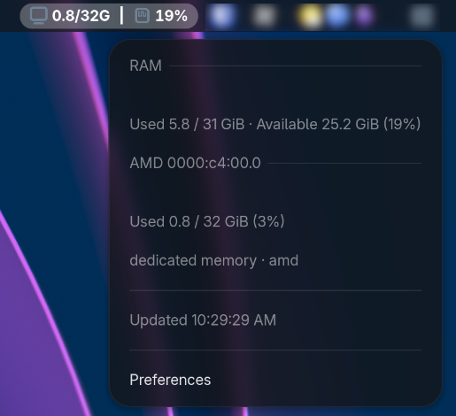
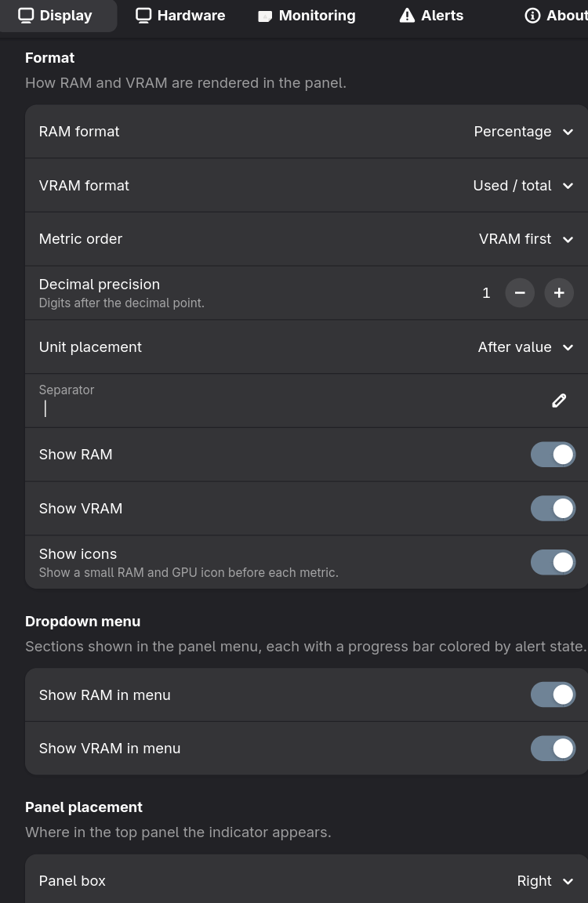
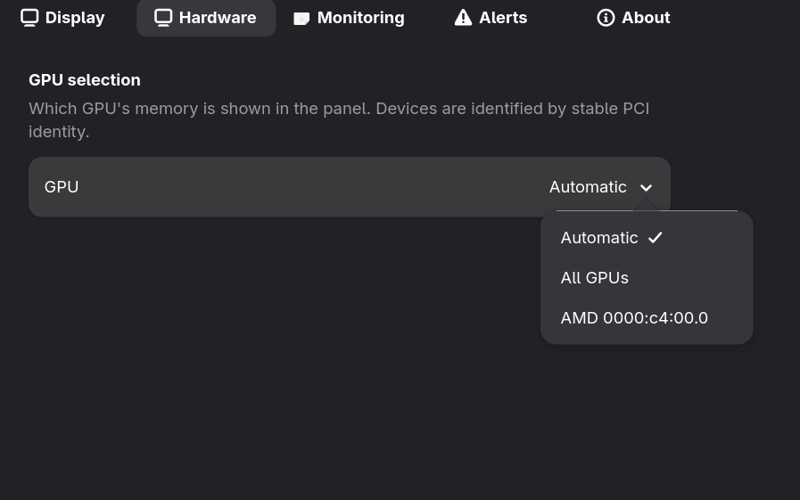
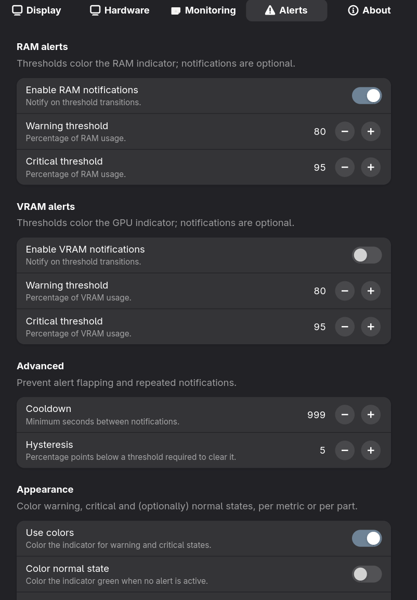
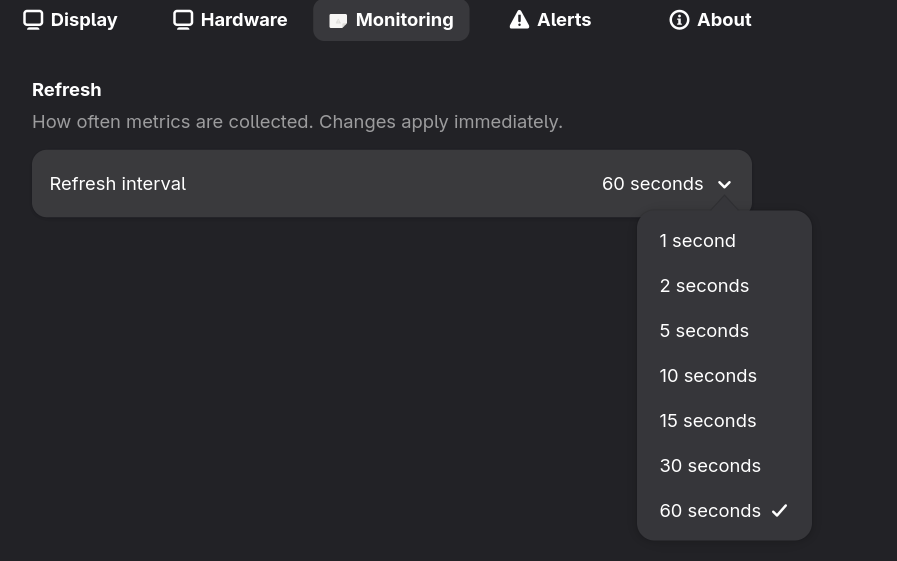

# Memory Monitor

A GNOME Shell extension that shows system RAM and GPU (VRAM) memory usage
directly in the top panel. It reads only `/proc/meminfo` and `/sys` — no network
access, no root privileges, and no synchronous subprocesses.

Vibe-coded with DeepSeek (coding & planning) and ChatGPT (planning).

## Features

- RAM and VRAM as numbers with configurable formats, precision, units,
  separators, per-metric visibility and icons.
- Configurable refresh interval (1–60 s, default **10 s**), applied live.
- Configurable panel placement (left/center/right + index).
- Native dropdown menu with per-metric progress bars colored by alert state.
- Multi-GPU discovery by stable PCI identity (AMD / Intel / NVIDIA) with
  truthful `dedicated` / `shared` / `local` / `visible` / `unavailable` semantics.
- Warning/critical alerts with hysteresis and transition-only notifications.

## Requirements

- Fedora Workstation on **Wayland** (tested on Fedora 44)
- GNOME Shell **50** (tested on 50.5)
- GTK4 / libadwaita for the preferences window

## Install

See [`INSTALL.md`](INSTALL.md), or build and install the packaged bundle:

```sh
./build.sh
gnome-extensions install memory-monitor@work_in_progress.shell-extension.zip
```

## Documentation

- [Extension README](memory-monitor@work_in_progress/README.md) — full feature list, data
  semantics, vendor support, settings table and troubleshooting.
- [Changelog](memory-monitor@work_in_progress/CHANGELOG.md)
- [Release notes](RELEASE-NOTES.md)

## Testing

```sh
gjs -m tests/run-tests.js
```

## Screenshots












## License

GPL-2.0-or-later. See [LICENSE](memory-monitor@work_in_progress/LICENSE).
